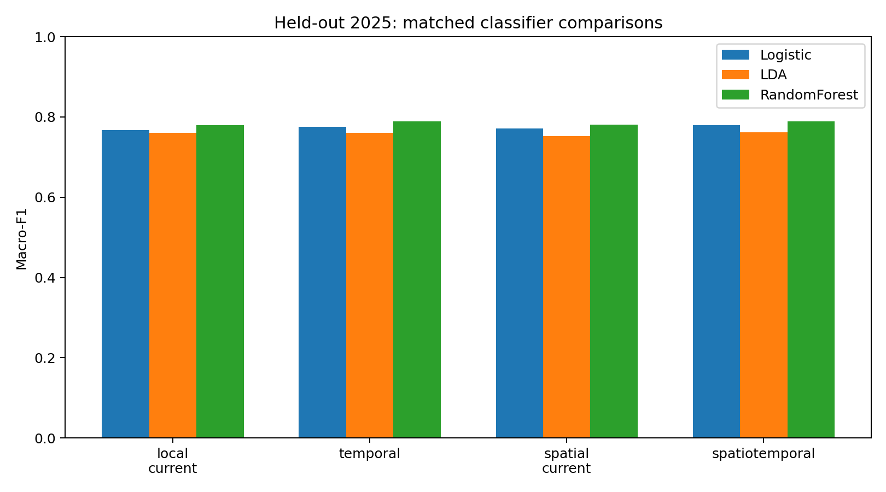
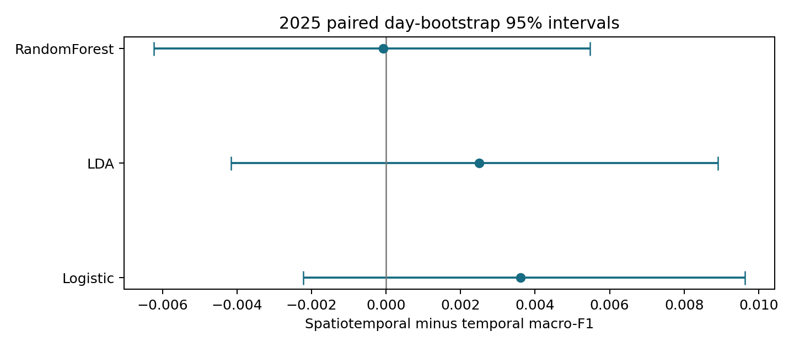

# Temporal versus Spatiotemporal Wind Regime Classification

Pattern Recognition semester project, Monsoon 2026.

**Research question:** does adding neighboring-station weather information improve next-hour Low / Medium / High wind classification over a local temporal representation?

The repository includes the unchanged supplied temporal and spatial forecasting code, a separate executable classical classification experiment, a detailed report, an editable methodology flow, and computed prediction-level evidence. The hypothesis is tested rather than assumed.

## Main finding

Spatial information gives small gains for logistic regression and LDA on the fixed 2025 cohort, while the primary random-forest comparison is essentially tied and slightly favors temporal inputs. Every paired day-bootstrap macro-F1 interval includes zero. **The experiment does not establish consistent spatiotemporal superiority.**

| Classifier | Temporal test accuracy | Spatiotemporal test accuracy | Temporal test macro-F1 | Spatiotemporal test macro-F1 | Change in macro-F1 |
| --- | --- | --- | --- | --- | --- |
| Logistic regression | 77.12% | 77.42% | 0.775804 | 0.779418 | +0.003614 |
| Shrinkage LDA | 75.21% | 75.40% | 0.759958 | 0.762464 | +0.002506 |
| Random forest, primary | 78.48% | 78.40% | 0.789425 | 0.789344 | -0.000082 |

The primary classifier is selected from **temporal 2024 validation macro-F1**, not from the displayed test scores. The same classifier and fixed settings are used in both arms. The 2025 cohort had been evaluated in an earlier local-only experiment; this is a fixed-protocol follow-up comparison, not a newly blind confirmatory test.

## Report and methodology

- [Detailed project report PDF](reports/Temporal_vs_Spatiotemporal_Report.pdf)
- [Editable report text, tables and figures](reports/Temporal_vs_Spatiotemporal_Report.md)
- [Methodology and editable flowchart](docs/METHODOLOGY.md)
- [Data dictionary](docs/DATA_DICTIONARY.md)
- [All results, predictions, matrices and audit files](results/classification/README.md)
- [Individual contributions to complete](CONTRIBUTIONS.md)

The report covers the hypothesis, data, category design, temporal/spatial source lineage, feature extraction, classical classifiers, fair comparisons, leakage controls, accuracy, macro-F1, confusion matrices, all per-class precision/recall, five-fold mean and SD, paired comparisons, uncertainty and limitations.

## Run the complete program

Recommended environment: **Python 3.11** and MATLAB. The pinned numerical packages support Python 3.10–3.12. The recorded run used Python 3.11.9 and MATLAB R2025b. A CPU is sufficient.

In MATLAB, open the repository root and run:

```matlab
Main
```

[`Main.m`](Main.m) runs every feature arm and classifier without asking for input, prints all required metrics, saves the evidence, and displays the confusion matrices and comparison chart. Python must be available as `python` or `py -3`. If numerical packages are missing, the launcher attempts `pip install -r requirements.txt`; that installation requires internet. The experiment itself uses the included data and makes no external data requests. A full CPU run can take several minutes.

Python-only execution:

```text
python -m pip install -r requirements.txt
python -B classification/run_experiment.py
python -B classification/check_results.py
```

Run either new classification arm separately:

```text
python -B classification/temporal_main.py
python -B classification/spatiotemporal_main.py
```

Separate runs write to `results/temporal_classification` and `results/spatiotemporal_classification`. Use the full comparison runner for matched hypothesis testing. Re-running overwrites that runner's generated result files, while supplied source and data remain unchanged.

## Dataset and category definitions

The target is **Brentwood, CIMIS station 47**. Fourteen supplied station files include the target and thirteen candidate neighbors. The target file contains 17,568 raw records, yielding **16,806 eligible labelled instances** after date and target-pair filtering. There are **10 raw meteorological attributes** and **3 classes**.

| Class | Wind at the next hour |
| --- | --- |
| Low | Below 3 mph |
| Medium | At least 3 and below 7 mph |
| High | At least 7 mph |

These are fixed project categories, not official weather warnings. The predictors are observed at hour `t`; the class is derived from wind at `t+1`. Current wind is therefore a valid predictor rather than the outcome being classified at the same instant.

2024 provides **8,413** development instances and 2025 provides **8,393** future-test instances. All feature arms use the same rows. Target pairs and history calculations remain within calendar days. Missing neighbor inputs are imputed using training data, so spatial models do not receive an easier or smaller evaluation cohort.

## Feature comparison

| Condition | Attributes | Information supplied |
| --- | --- | --- |
| Local current | 10 | Current Brentwood weather |
| Temporal | 22 | Local current, past wind features, temperature/dew-point spread, circular time and direction |
| Spatial current | 28 | Local current, neighbor current weather, weighted summaries and target/neighbor differences |
| Spatiotemporal | 46 | Temporal information plus neighbor current weather, neighbor wind histories and weighted summaries |

Three neighbors are fixed by geographic distance before comparison: **Davis (68.33 km), Camino (122.14 km), and Firebaugh/Telles (152.49 km)**. Normalized inverse-distance weights are about 0.4981, 0.2787 and 0.2232. Neighbor selection does not use test scores, wind correlations or target labels. The classification features use deterministic geographic aggregation, not a neural graph layer.

The four conditions form ablation controls. Comparing temporal against spatiotemporal isolates the addition of the specified spatial feature package for the same estimator. It does not prove which individual added feature causes a change.

## Evaluation

Five stratified calendar-day grouped folds on 2024 approximately preserve class proportions and keep a day's overlapping histories and target pairs together. All arms share the same folds. Each estimator fits median imputation and scaling only on its training subset. Settings are fixed across arms: logistic regression, shrinkage LDA, and a random forest. Persistence predicts the next-hour category from current wind.

| Classifier | Temporal CV accuracy mean ± SD (%) | Spatiotemporal CV accuracy mean ± SD (%) | Temporal CV macro-F1 mean ± SD | Spatiotemporal CV macro-F1 mean ± SD |
| --- | --- | --- | --- | --- |
| Logistic | 75.22 ± 0.87 | 75.53 ± 0.91 | 0.7592 ± 0.0079 | 0.7619 ± 0.0084 |
| LDA | 74.20 ± 0.82 | 74.01 ± 0.79 | 0.7503 ± 0.0090 | 0.7476 ± 0.0092 |
| Random forest | 77.06 ± 0.72 | 77.37 ± 0.40 | 0.7762 ± 0.0080 | 0.7796 ± 0.0036 |

SD is the sample spread across five validation folds, not a confidence interval. A paired 2,000-resample calendar-day bootstrap supplies conditional 95% intervals for final-test differences. Neighboring days can remain dependent; the intervals do not account for model-fitting uncertainty or a second population of stations. All accuracy/F1 values and per-class metrics can be recomputed from saved predictions.





## Original temporal main code and spatial code

| Source | Meaning |
| --- | --- |
| [`L/run.py`](L/run.py) | Earlier local temporal forecasting baseline |
| [`L.1/run.py`](L.1/run.py) | Local temporal forecasting entry point with hybrid selection |
| [`L.1/source/model.py`](L.1/source/model.py) | Original KANInformer temporal architecture |
| [`spatial_L.1/run.py`](spatial_L.1/run.py) | Target-only spatial forecasting entry point |
| [`common/graph_model.py`](common/graph_model.py) | Graph context adapter around the temporal backbone |
| [`classification/temporal_main.py`](classification/temporal_main.py) | New classical temporal classification entry point |
| [`classification/spatiotemporal_main.py`](classification/spatiotemporal_main.py) | New classical spatiotemporal classification entry point |

The original forecasting sources and data remain byte-for-byte unchanged. [`docs/original_source_manifest.json`](docs/original_source_manifest.json) fingerprints all 50 files present before this classification study. The original `run_all.py` still refers to forecasting. Its optional dependencies are in `requirements-forecasting.txt`; they are separate from the lightweight classical requirements. Full-season original forecasting preprocessing is not reused by classification. The retained `description.md` describes the earlier code snapshot and is historical documentation.

`best_results.csv` contains earlier continuous regression metrics, not the new classification results. Comparing its RMSE/MAE/MAPE against accuracy/F1 would mix tasks. The new report uses freshly computed categorical predictions only. Deep learning is not the main course experiment.

## Repository layout

```text
Main.m                         complete course classification entry point
classification/                comparison, separate arm runners, verification
data/                          supplied weather CSVs and station coordinates
docs/                          methodology, data dictionary, original hashes
reports/                       detailed PDF and editable report
results/classification/        scores, predictions, folds, matrices, figures
tools/                         report and scientific-figure builders
L/, L.1/, spatial_L.1/, common/ unchanged original forecasting implementation
requirements.txt               executed classical numerical dependencies
requirements-report.txt        optional report-generation dependencies
requirements-forecasting.txt   optional original forecasting dependencies
CONTRIBUTIONS.md               actual individual attribution to complete
```

## Regenerate the report

After generating the complete comparison results:

```text
python -m pip install -r requirements-report.txt
python -B tools/build_figures.py
python -B tools/build_report.py
```

Report tools consume saved evidence and do not tune models. The PDF was rendered and inspected separately for layout.

## Limitations and submission

This is one station, three fixed neighbors and one future year. Thresholds need domain validation. Archived sensor quality flags and real-time data latency were not exhaustively assessed. The class and feature transformations are standard engineering choices, not a new classifier or a reproduced neural classification benchmark. The findings are descriptive and inconclusive about consistent spatial benefit.

Before submission, provide actual team names, roll numbers and contributions in the report appendix. Confirm the topic is unique within the course, and keep this repository accessible until grades are awarded.

Weather source: [California CIMIS](https://cimis.water.ca.gov/) and [weather report resources](https://cimis-proxy.water.ca.gov/Resources.aspx). Evaluation references: [scikit-learn cross-validation](https://scikit-learn.org/stable/modules/cross_validation.html) and [training-only preprocessing](https://scikit-learn.org/stable/common_pitfalls.html). Original KANInformer-related work is cited in the detailed report. No blanket license is asserted over supplied third-party data or source material.
