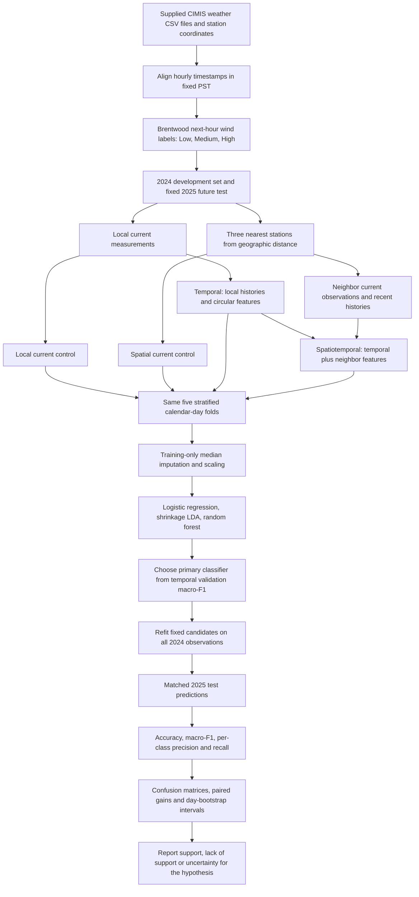

# Methodology

## Research question and hypotheses

Does adding geographically neighboring weather observations and their recent histories improve next-hour wind-regime classification at Brentwood, compared with local temporal information alone?

- **Directional research hypothesis:** for the same classifier, spatiotemporal features increase held-out macro-F1 over temporal features.
- **Null working hypothesis:** spatial context does not increase macro-F1 on the evaluated future year.
- **Primary comparison:** select a classifier from the temporal arm's 2024 cross-validation results, then compare that same fixed classifier using temporal versus spatiotemporal inputs on 2025.
- **Secondary comparisons:** repeat the matched feature comparison for each fixed classifier and include current-only feature ablations.

The hypothesis is a question to test. A negative or inconclusive result remains part of the report. The code never edits labels or predictions to create an improvement.

## Methodology flow

## Target construction

For each observation hour t, predict the class of Brentwood wind speed at t+1 hour:

| Class | Next-hour wind speed |
| --- | --- |
| Low | less than 3 mph |
| Medium | at least 3 and less than 7 mph |
| High | at least 7 mph |

Thresholds are fixed project choices. They are not official weather warnings or a calibrated operational policy. Current wind is a legitimate predictor for next-hour wind, not the value being classified at the same hour. Future wind is used only to construct the outcome.

Retain 2024 and 2025 feature timestamps. A target must be observed, nonnegative, exactly one hour after its feature timestamp and on the same calendar day. An explicit complete hourly index ensures that a row shift is an hourly shift. All arms use identical target rows. Missing neighbors never cause one arm to receive a different test cohort.

## Feature conditions

| Condition | Attributes | Contents |
| --- | --- | --- |
| Local current | 10 | Current Brentwood meteorological attributes |
| Temporal | 22 | Local current plus 12 extracted local features |
| Spatial current | 28 | Local current plus 12 neighbor measurements and 6 weighted summaries/differences |
| Spatiotemporal | 46 | Temporal plus 12 neighbor measurements, 6 neighbor history attributes and 6 summaries/differences |

The ten raw variables are evapotranspiration, precipitation, solar radiation, vapor pressure, air temperature, relative humidity, dew point, wind speed, wind direction and soil temperature. Units remain as supplied in the CSV. The radiation column retains its supplied label, without independently certifying that label's hourly semantics.

Local extracted features are one-hour and three-hour wind lags, trailing three-hour wind mean and sample SD, wind change from the previous hour, temperature minus dew point, and sine/cosine pairs for direction, hour and annual position. Trailing windows include the current observation and available earlier observations only. Histories reset at midnight.

Three neighbors are chosen by smallest haversine distance to Brentwood, using the supplied coordinates alone: Davis, Camino and Firebaugh/Telles. At each station, current wind, temperature, humidity and vapor pressure supply four attributes. The spatiotemporal arm additionally receives the station's one-hour wind lag and trailing three-hour wind mean.

For distance d_i, fixed geographic weight w_i is proportional to 1/d_i and normalized to sum to one. For wind, temperature and humidity, compute an available-neighbor weighted mean and Brentwood minus that mean. If every neighbor is missing, the mean remains missing. When only some are observed, renormalize weights over those observed neighbors. Missing feature cells receive a median fitted on the current training fold only.

This is deterministic geographic feature aggregation followed by a classical classifier. It is not a neural graph convolution, a newly trained KANInformer head, or a numerical reproduction of the retained continuous forecasting experiment.

## Classifiers and fair comparison

Use logistic regression (C=1, balanced class weights, at most 2,000 iterations), LDA (lsqr solver, automatic covariance shrinkage), and random forest (160 trees, depth 14, minimum leaf size 3, balanced subsample weights, seed 42). All settings are fixed for every feature arm. The forest retains scikit-learn's default square-root feature sampling. No hyperparameter search is performed on the final test set. Persistence predicts the next-hour category from the current wind category.

Each learned pipeline contains median imputation, standard scaling, and the classifier. Both imputation and scaling fit only on the relevant training subset. Scaling is unnecessary for trees but retained for a consistent pipeline. No supervised feature selection or PCA uses held-out data.

## Evaluation and uncertainty

Use 2024 for development. Five StratifiedGroupKFold partitions approximately preserve class balance and keep each calendar day together. All arms use the same folds. Calendar-day grouping prevents overlapping within-day histories and next-hour labels from crossing folds, although weather dependence across days remains possible. Thus validation is a retrospective grouped comparison, not rolling-origin forecasting. Report its mean and sample SD across the five folds.

Select the primary classifier using only temporal validation macro-F1. Refit every fixed candidate on all 2024 data, then report all final 2025 scores. The primary spatiotemporal comparator uses the same classifier and fixed settings, so the intended comparison measures the added feature package. Test results must not change model selection, thresholds, features or settings.

Report accuracy, unweighted three-class macro-F1, confusion matrices, per-class precision/recall/F1, five-fold mean and sample SD (ddof=1), and paired spatiotemporal-minus-temporal differences. Zero-denominator class metrics are assigned zero.

Use 2,000 paired calendar-day bootstrap resamples of final test predictions to estimate percentile 95% intervals for accuracy and macro-F1 differences. The same sampled day multiplicities apply to both arms. These conditional intervals address within-day dependence but do not model dependence across days, model-fitting uncertainty or a second population of stations. They are supporting diagnostics, not a blanket proof of statistical significance.

## Source lineage and limitations

The 2025 cohort was previously evaluated in an earlier local-only classification experiment. This fixed-protocol follow-up does not retune the candidate settings after its new spatial comparison, but it is not a newly blind confirmatory test. An independent year or station would be needed for that stronger claim.

The original temporal implementation is `L.1/run.py` with `L.1/source/model.py`; `L/run.py` is an earlier local selection baseline. `spatial_L.1/run.py` adds the graph adapter in `common/graph_model.py`. Those source files remain unchanged. The classification adaptation is independent and uses classical methods as required by the course.

Original full-season cleaning/decomposition behavior is not reused by this new classification pipeline. Original regression RMSE/MAE/MAPE in `best_results.csv` cannot be converted into classification accuracy or macro-F1. The classification report uses freshly generated category predictions.

Limits include one target station, one future year, fixed project thresholds, remaining weather dependence, imperfect timestamp/availability semantics of an archived dataset and no exhaustive CIMIS quality-flag filtering. Spatial inputs assume all selected stations' current hourly observations are available at prediction time. There is no measured deployment latency, alarm utility, power-generation benefit or causal effect.

## References

- California Department of Water Resources, [CIMIS](https://cimis.water.ca.gov/) and [weather report resources](https://cimis-proxy.water.ca.gov/Resources.aspx).
- scikit-learn, [cross-validation](https://scikit-learn.org/stable/modules/cross_validation.html) and [data leakage and pipelines](https://scikit-learn.org/stable/common_pitfalls.html).
- Supplied spatial forecasting manuscript and retained local temporal/spatial source code. They motivate the information comparison but do not supply classification scores.
