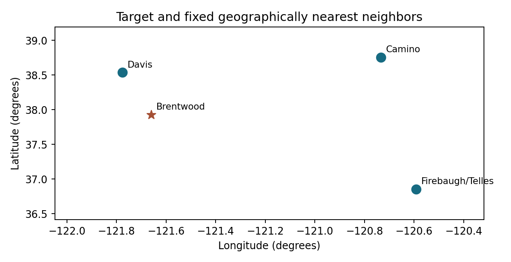
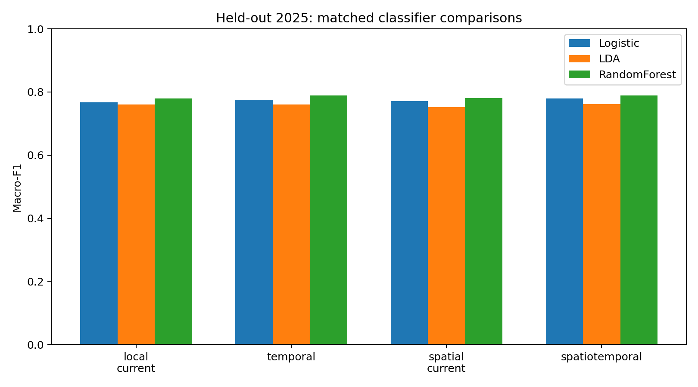
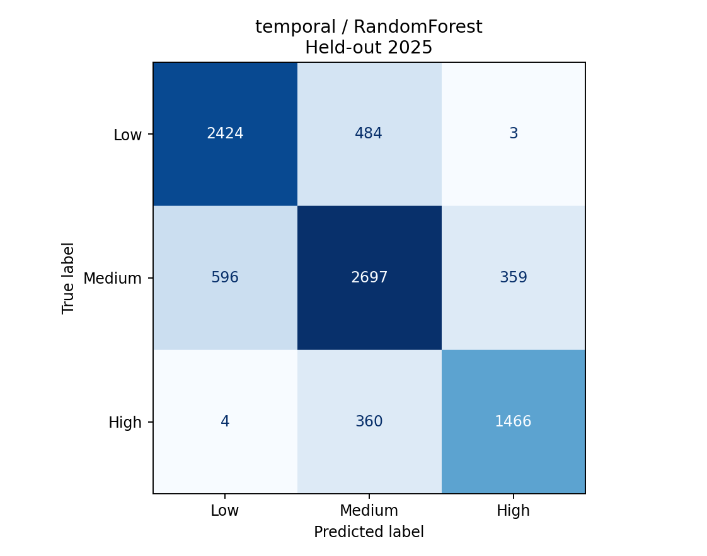
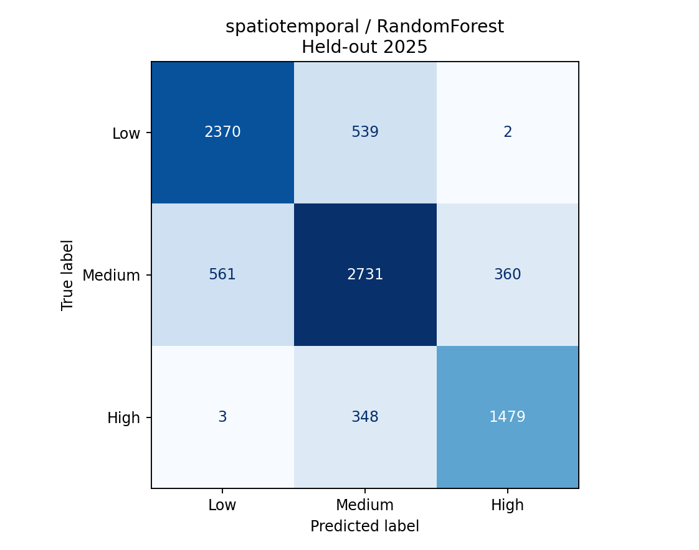
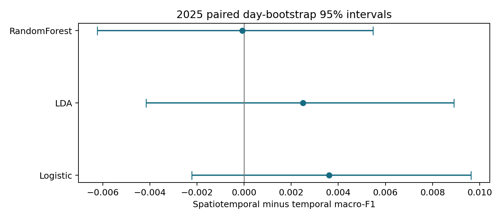

Temporal and Spatiotemporal Wind Regime Classification

A classical pattern recognition study of low medium and high next hour wind speed

Semester project for Pattern Recognition
Monsoon 2026
Report date 5 November 2026

Research hypothesis

Adding neighboring-station weather observations and their recent histories to local temporal features will improve next-hour wind-regime classification at Brentwood.

Abstract

The supplied weather records are reformulated as a supervised three-class problem with fixed Low, Medium and High next-hour wind-speed labels. The experiment uses 16,806 instances, ten raw meteorological attributes, and four matched feature conditions containing 10, 22, 28 and 46 attributes. Logistic regression, shrinkage linear discriminant analysis and a random forest form the main comparison. Five stratified calendar-day grouped folds on 2024 support model selection and mean plus sample-standard-deviation reporting. The complete 2025 year remains a future test set. The primary classifier, selected from temporal validation macro-F1, is RandomForest. Temporal inputs achieve 78.48% accuracy and 0.789425 macro-F1. Spatiotemporal inputs achieve 78.40% and 0.789344. Logistic regression and LDA show small test macro-F1 gains from spatial inputs, but the primary forest comparison does not improve. All paired day-bootstrap intervals include zero. The study therefore finds classifier-dependent, inconclusive spatial benefit rather than consistent superiority.

Repository and deliverable scope

<link href="https://github.com/medhanshrao20/pr">https://github.com/medhanshrao20/pr</link>

Main.m runs the complete new classification experiment and displays the required results. Original temporal and spatial forecasting code remains unchanged. This deliverable contains the report, methodology, executable code and computed evidence.

---

1 Problem formulation and dataset

Short-term weather monitoring can benefit from a compact forecast of wind conditions. The real-world question here is whether other stations provide information beyond a target station's own recent observations. The target is a future category at Brentwood, not current wind reconstructed from itself. No power-generation or safety-warning benefit is inferred from these classification scores.

| Dataset property | Value |
| --- | --- |
| Source | Supplied California CIMIS hourly station files |
| Target | Brentwood station 47 |
| Candidate stations | 14 including Brentwood |
| Raw target records | 17,568 |
| Usable classification instances | 16,806 |
| 2024 training / development | 8,413 |
| 2025 future test | 8,393 |
| Raw attributes / target classes | 10 / 3 |

Fixed category definitions

| Category | Wind at t + 1 hour | 2024 count | 2025 count |
| --- | --- | --- | --- |
| Low | Below 3 mph | 2698 | 2911 |
| Medium | 3 to below 7 mph | 3763 | 3652 |
| High | At least 7 mph | 1952 | 1830 |

Thresholds are fixed project design choices, not an official meteorological warning scale. Labels are derived only from next-hour target wind. Current target wind may appear among the predictors because it is available one hour before the outcome. A label is accepted only when the target is observed, nonnegative, exactly one hour later, and on the same calendar day. Observations outside 2024 and 2025 are excluded.

All arms use identical rows and outcomes. The raw target record count decreases by 762 after date and target-pair eligibility rules. Missing predictors and missing neighbors remain eligible and are imputed from training medians. The supplied quality-control columns are not predictors, and no exhaustive quality-flag filtering is claimed.

---

2 Temporal and spatial source lineage

The existing repository contains a local temporal forecasting architecture and a target-only spatial adaptation. The temporal code was identified directly in the supplied tree. A separate classification implementation is added so that the course comparison focuses on classical pattern recognition and newly computed categorical outcomes.

| Existing source | Role |
| --- | --- |
| L/run.py | Earlier local baseline with fixed seasonal mode counts and validation-based alpha selection. |
| L.1/run.py | Local temporal entry point for hybrid decomposition-parameter selection. |
| L.1/source/model.py | Original KANInformer temporal backbone. |
| spatial_L.1/run.py | Forecasting entry point for target-only spatial context. |
| common/graph_model.py | Graph adapter around the temporal backbone. Its Ridge pathway remains Brentwood-only. |
| common/experiment.py | Original new-data adapters, seasonal experiments and output management. |

Classification adaptation

The new temporal classifier consumes Brentwood measurements and past-only features. The new spatiotemporal classifier receives the same local representation plus geographically neighboring measurements and histories. Both use the same estimator settings, labels, data partitions and scoring functions. The added spatial computation is a deterministic geographic feature aggregation, not a newly trained graph neural network.

| New entry point | Purpose |
| --- | --- |
| Main.m | Complete classification comparison and result display. |
| classification/run_experiment.py | All four feature conditions, matched classifiers and evidence generation. |
| classification/temporal_main.py | Independent temporal classification runner. |
| classification/spatiotemporal_main.py | Independent spatiotemporal classification runner. |
| classification/check_results.py | Metric, cohort, fold, causality and integrity checks. |

The 50 pre-existing source and data files are fingerprinted in docs/original_source_manifest.json and remain unchanged. Original continuous forecasting RMSE, MAE and MAPE in best_results.csv are retained as historical regression evidence. They cannot be converted into classification accuracy, macro-F1 or a confusion matrix. No old regression result is presented as a new categorical prediction.

---

3 Methodology flow and experimental logic

See docs/METHODOLOGY.md for the editable Mermaid methodology flow.

Figure 1. Classification methodology. Each feature arm uses the same target rows and paired validation/test observations. The primary classifier is selected from temporal validation results before test scoring.

Directional hypothesis and primary comparison

The research hypothesis predicts a positive spatiotemporal-minus-temporal macro-F1 difference. The working null is no increase. To avoid selecting whichever final result looks favorable, the classifier family is fixed using only the temporal arm's 2024 validation macro-F1. That same classifier then supplies the primary comparison between feature sets. Other classifiers provide secondary checks.

Ablation controls

Local-current versus temporal evaluates extracted local histories and circular attributes. Local-current versus spatial-current evaluates contemporaneous neighbor information. Temporal versus spatiotemporal is the principal feature-package comparison. The spatiotemporal package adds both neighbor current measurements and neighbor histories, so this design cannot isolate each individual added feature or separate geographic weighting from the rest of the package.

A more complex condition can help or hurt. Model-selection criteria, category thresholds, neighbors and classifier settings do not change after the test results become visible. Negative and inconclusive findings are retained.

---

4 Local and geographic feature construction

| Condition | Attributes | Information |
| --- | --- | --- |
| Local current | 10 | Current Brentwood weather |
| Temporal | 22 | Local current plus past and circular attributes |
| Spatial current | 28 | Local current plus neighbor current observations and summaries |
| Spatiotemporal | 46 | Temporal plus neighbor current observations, histories and summaries |

The ten raw attributes are evapotranspiration, precipitation, solar radiation, vapor pressure, air temperature, relative humidity, dew point, wind speed, wind direction and soil temperature. Units follow the supplied CSV. The sol_rad_ly_per_day label is retained without independently verifying the hourly semantics implied by its name.

The temporal condition adds wind lags at one and three hours, trailing three-hour mean and sample SD, one-hour wind change, temperature minus dew point, and sine/cosine pairs for wind direction, hour of day and annual position. Circular encoding uses sin(theta) and cos(theta), with theta set by the corresponding period. Trailing windows use the current observation and earlier observations only. Histories reset at day boundaries; missing early-day histories are imputed within the training pipeline.

| Neighbor | Distance from Brentwood | Geographic weight |
| --- | --- | --- |
| Davis | 68.33 km | 0.4981 |
| Camino | 122.14 km | 0.2787 |
| Firebaugh/Telles | 152.49 km | 0.2232 |

Coordinates and haversine distance fix the three nearest neighbors. Weights are normalized inverse distances. Each neighbor supplies current wind, temperature, humidity and vapor pressure; the spatiotemporal arm adds its one-hour wind lag and trailing three-hour mean. For wind, temperature and humidity, weighted neighbor means and local-minus-neighbor differences add six summaries. Means renormalize over observed neighbors and remain missing if none are observed.

Figure 2. Station coordinate plot, without a basemap. Geographic separation motivates the fixed neighbor set but does not prove predictive dependence.

---

5 Classical models and leakage controls

| Classifier | Fixed configuration |
| --- | --- |
| Logistic regression | L2 regularization, C=1, balanced class weights, maximum 2,000 iterations, seed 42. |
| Shrinkage LDA | lsqr solver with automatic covariance shrinkage. |
| Random forest | 160 trees, depth 14, minimum leaf size 3, balanced subsample weights, default square-root feature sampling, seed 42. |
| Persistence | Predict the next-hour category from current Brentwood wind. Missing current wind uses the training median. |

Each learned classifier uses median imputation and standard scaling fitted on its training subset only. Tree models do not require scaling, but the same pipeline structure is retained. No full-season decomposition, backward fill, centered window, future neighbor value, supervised full-data feature selection or PCA enters the classification pipeline. The retained forecasting program's full-season preprocessing is not reused.

Training validation and test partitions

Calendar year 2024 is the development pool. Five StratifiedGroupKFold partitions, with shuffle enabled and seed 42, approximately preserve class proportions while assigning each calendar day entirely to one fold. All folds contain every class. Every candidate uses the same folds. Within-day histories and next-hour labels therefore cannot overlap across training and validation groups. Days can still share weather regimes, so grouped validation is retrospective rather than a rolling-origin operational simulation.

The full 2025 year forms a separate future holdout. Every candidate is refitted on all 2024 observations before final scoring. No test score controls selection, hyperparameters or neighbor choice. The classification study uses classical estimators only. The original deep temporal/spatial forecasting code provides source lineage and related context, not a directly comparable categorical benchmark.

Metrics and uncertainty

Accuracy is the fraction of correct labels. For a class, precision = TP / (TP + FP), recall = TP / (TP + FN), and F1 = 2PR / (P + R). Macro-F1 averages the three class F1 scores equally. Undefined class ratios receive zero. Reported SD is the sample standard deviation across five validation folds (ddof=1), not a confidence interval. A paired calendar-day bootstrap of 2,000 resamples provides conditional percentile 95% intervals for final-test differences. It does not model across-day dependence or model-fitting uncertainty.

---

6 Five fold validation results

| Condition | Classifier | Accuracy mean +/- SD | Macro-F1 mean +/- SD |
| --- | --- | --- | --- |
| Local current | Logistic | 74.72 +/- 0.90 | 75.40 +/- 0.84 |
| Local current | LDA | 73.92 +/- 0.97 | 74.73 +/- 1.03 |
| Local current | RandomForest | 76.33 +/- 0.54 | 76.94 +/- 0.42 |
| Temporal | Logistic | 75.22 +/- 0.87 | 75.92 +/- 0.79 |
| Temporal | LDA | 74.20 +/- 0.82 | 75.03 +/- 0.90 |
| Temporal | RandomForest | 77.06 +/- 0.72 | 77.62 +/- 0.80 |
| Spatial current | Logistic | 75.43 +/- 0.92 | 76.08 +/- 0.82 |
| Spatial current | LDA | 73.77 +/- 0.78 | 74.43 +/- 0.89 |
| Spatial current | RandomForest | 77.03 +/- 0.52 | 77.61 +/- 0.58 |
| Spatiotemporal | Logistic | 75.53 +/- 0.91 | 76.19 +/- 0.84 |
| Spatiotemporal | LDA | 74.01 +/- 0.79 | 74.76 +/- 0.92 |
| Spatiotemporal | RandomForest | 77.37 +/- 0.40 | 77.96 +/- 0.36 |
| Persistence | Persistence | 74.49 +/- 0.40 | 75.15 +/- 0.45 |

Table 1. Validation scores on a 0 to 100 scale, with sample SD in percentage points. Models use 2024 observations only. Same folds across all rows.

Temporal validation selects RandomForest, whose mean macro-F1 is 0.7762. The same classifier is used in the primary spatiotemporal comparison. For that model, the paired validation macro-F1 change is +0.344 +/- 0.737 points. The mean of paired fold differences and its SD are computed from matched folds, rather than subtracting unrelated SDs.

| Classifier | Paired accuracy change mean +/- SD | Paired macro-F1 change mean +/- SD |
| --- | --- | --- |
| Logistic | +0.311 +/- 0.580 | +0.271 +/- 0.561 |
| LDA | -0.191 +/- 0.548 | -0.274 +/- 0.607 |
| RandomForest | +0.308 +/- 0.782 | +0.344 +/- 0.737 |

Table 2. Spatiotemporal minus temporal validation changes, on a 0 to 100 scale. Positive means the spatial feature package improves the score.

Validation supports trying spatial features, but validation gains do not establish gains on a later year. Keeping the future holdout separate is necessary to check that distinction.

---

7 Final future year classification results

| Condition | Classifier | Attributes | Accuracy | Macro-F1 |
| --- | --- | --- | --- | --- |
| Local current | Logistic | 10 | 76.33% | 0.767494 |
| Local current | LDA | 10 | 75.32% | 0.761066 |
| Local current | RandomForest | 10 | 77.48% | 0.779551 |
| Temporal | Logistic | 22 | 77.12% | 0.775804 |
| Temporal | LDA | 22 | 75.21% | 0.759958 |
| Temporal | RandomForest | 22 | 78.48% | 0.789425 |
| Spatial current | Logistic | 28 | 76.64% | 0.771363 |
| Spatial current | LDA | 28 | 74.43% | 0.752288 |
| Spatial current | RandomForest | 28 | 77.51% | 0.780659 |
| Spatiotemporal | Logistic | 46 | 77.42% | 0.779418 |
| Spatiotemporal | LDA | 46 | 75.40% | 0.762464 |
| Spatiotemporal | RandomForest | 46 | 78.40% | 0.789344 |
| Persistence | Persistence | 10 | 75.47% | 0.760665 |

Table 3. All candidates use the same 8,393 final-test instances from 2025. Six decimal places in macro-F1 preserve the very small primary-arm difference.

Figure 3. Held-out macro-F1 for the four matched information conditions. Classifier settings are fixed across feature arms.

The temporal random forest has the highest test accuracy among these fixed candidates. This observation does not change the prespecified classifier choice. The spatiotemporal condition improves the final-test macro-F1 of logistic regression and LDA, while the random-forest macro-F1 is slightly lower. More attributes alone do not guarantee improvement.

---

8 Primary comparison and class behavior

Figure 4. Temporal (left) and spatiotemporal (right) random-forest confusion matrices. Rows are true categories and columns are predictions. Both use exactly the same test outcomes.

| Arm and class | Precision | Recall | F1 | N |
| --- | --- | --- | --- | --- |
| Temporal Low (<3 mph) | 0.8016 | 0.8327 | 0.8168 | 2911 |
| Temporal Medium (3 to <7 mph) | 0.7616 | 0.7385 | 0.7499 | 3652 |
| Temporal High (>=7 mph) | 0.8020 | 0.8011 | 0.8015 | 1830 |
| Spatiotemporal Low (<3 mph) | 0.8078 | 0.8142 | 0.8109 | 2911 |
| Spatiotemporal Medium (3 to <7 mph) | 0.7548 | 0.7478 | 0.7513 | 3652 |
| Spatiotemporal High (>=7 mph) | 0.8034 | 0.8082 | 0.8058 | 1830 |

The spatial package changes which categories benefit. Low-class recall falls from 0.8327 to 0.8142, while Medium recall rises from 0.7385 to 0.7478 and High recall rises from 0.8011 to 0.8082. These shifts nearly offset in macro-F1. Accuracy decreases by seven correct predictions out of 8,393, or about 0.083 percentage points. This is consistent with a small redistribution of errors rather than a clear overall benefit.

Most confusions remain between adjacent categories. The feature thresholds create natural boundary cases, and Medium wind lies between two alternatives. Per-class precision and recall therefore remain necessary even when the headline macro-F1 values are almost equal.

---

9 Hypothesis assessment and uncertainty

| Classifier | Test accuracy difference | Test macro-F1 difference | 95% interval for macro-F1 difference |
| --- | --- | --- | --- |
| Logistic | +0.298 points | +0.003614 | [-0.002213, +0.009630] |
| LDA | +0.191 points | +0.002506 | [-0.004157, +0.008909] |
| RandomForest | -0.083 points | -0.000082 | [-0.006236, +0.005480] |

Table 4. Spatiotemporal minus temporal. Intervals use 2,000 paired calendar-day bootstrap resamples of 365 test days. Every interval includes zero.

Figure 5. Positive point estimates favor spatial information. Overlap with zero indicates that these conditional intervals do not establish a positive gain.

Primary verdict

The prespecified primary comparison is RandomForest. Its test macro-F1 difference is -0.000082, with conditional 95% interval [-0.006236, +0.005480]. This experiment does not support consistent spatiotemporal superiority. The near-zero point difference is insufficient evidence that spatial information is harmful in general, just as the positive secondary differences are insufficient evidence of universal benefit.

Secondary observations

Logistic regression and LDA obtain small positive test macro-F1 changes. Their intervals also cross zero. The direction differs by classifier and differs between validation and future-year evaluation for LDA. The result is therefore best described as classifier-dependent and inconclusive. A report that claimed spatial dominance from only the favorable rows would misrepresent the complete comparison.

The bootstrap treats days as resampling blocks. It preserves within-day pairing but does not remove correlation between adjacent days. It is conditional on one fitted model per arm, one station and one year. These intervals are supporting diagnostics rather than a comprehensive significance claim.

---

10 Interpretation limitations and conclusion

Interpretation

Local wind persistence is already strong. A neighboring measurement may be redundant with Brentwood's recent wind, or describe a different local weather regime. The selected stations are approximately 68 to 152 km from the target. Geographic closeness does not establish that their current readings lead the target by the relevant forecast horizon. Extra features also change the forest's randomly sampled feature subsets, so estimator behavior can vary even when spatial information is weak.

The controls help separate information packages. Temporal features improve the raw random-forest condition, whereas adding only neighbor current observations yields little change in its test macro-F1. The combined condition has a small validation benefit without an overall future-test gain. These are descriptive effects of the complete feature packages, not causal claims about individual meteorological variables.

Limitations

The study has one target station, a single future year, three geographically selected neighbors and fixed project category thresholds. Reported units follow the archived files. No comprehensive quality-flag cleaning, sensor latency study or deployment check is included. Neighbor features assume measurements at the current hour are available in time. Grouped folds can retain across-day weather dependence, and bootstrap intervals are conditional on the fitted models. No deep-learning classification comparator or original forecasting-model retraining was performed.

The 2025 cohort was previously evaluated in an earlier local-only classification experiment. This is a fixed-protocol follow-up comparison, without retuning after its new spatial results, rather than a newly blind confirmatory test. An independent year or station is needed for stronger confirmation.

Conclusion

The wind-speed forecasting context can be formulated as a valid multiclass pattern-recognition experiment while preserving existing source files. The reproducible comparison satisfies the dataset size, attribute count, class count and classical-method focus, and reports accuracy, macro-F1, all per-class measures, confusion matrices and validation mean plus SD. The tested spatial feature package does not establish consistent improvement over the temporal baseline. The value of the project is a fair, auditable test of that hypothesis, including its mixed outcome.

Future work

Before an additional test, specify physically motivated lag alignment, candidate neighbor sets and category definitions using training/validation data only. Expand to other target stations and years, assess sensor availability, and use a nested chronological design. Additional comparisons should remain prespecified and retain negative results.

---

11 References and reproducibility

[1] California Department of Water Resources. California Irrigation Management Information System. https://cimis.water.ca.gov/. Weather report resources: https://cimis-proxy.water.ca.gov/Resources.aspx. Accessed 5 November 2026.

[2] scikit-learn developers. Cross-validation: evaluating estimator performance. https://scikit-learn.org/stable/modules/cross_validation.html. Grouped and stratified validation guidance. The executed environment uses scikit-learn 1.3.2.

[3] scikit-learn developers. Common pitfalls and recommended practices. https://scikit-learn.org/stable/common_pitfalls.html. Training-only transformations and pipelines.

[4] Leng Z, Chen L, Yi B, Liu F, Xie T, Mei Z. Short-term wind speed forecasting based on a novel KANInformer model and improved dual decomposition. Energy 322, 135551 (2025). https://doi.org/10.1016/j.energy.2025.135551. Related forecasting work cited by the supplied manuscript, not a classification benchmark.

Run and verify

Clone https://github.com/medhanshrao20/pr. In MATLAB, run Main.m to generate every classification arm, score table, prediction table and confusion figure. Python-only execution: python -B classification/run_experiment.py. Verification: python -B classification/check_results.py. Separate temporal and spatiotemporal entry points are included for inspection and isolated reruns. They use separate output folders.

Install numerical dependencies from requirements.txt. MATLAB automatically attempts installation if required Python imports are missing. Report regeneration additionally requires requirements-report.txt, then python tools/build_figures.py and python tools/build_report.py. Report generation consumes saved evidence and does not fit or tune models. The original forecasting dependencies are isolated in requirements-forecasting.txt and are not needed for the new classical experiment.

| Runtime item | Recorded version |
| --- | --- |
| python | 3.11.9 |
| numpy | 1.26.4 |
| pandas | 2.2.2 |
| scikit_learn | 1.3.2 |
| matplotlib | 3.10.0 |
| Random seed | 42 |
| Validation folds | 5 |
| Bootstrap resamples | 2,000 |

The dataset, coordinate and original-source SHA-256 hashes are preserved in the input audit and source manifest. Saved test and validation predictions permit recomputation of metrics. split_assignments.csv records timestamp-level partitions. Keep the repository accessible until course grades are awarded. No perpetual hosting guarantee or third-party material license is inferred.

Appendix A Individual contributions

Team members must supply and verify their names, roll numbers and actual contributions before submission. No individual authorship or work allocation is inferred from repository ownership. Complete CONTRIBUTIONS.md and update this appendix with the verified information.

---

Appendix B1 All per class results for Logistic

| Condition and category | Precision | Recall | F1 | N |
| --- | --- | --- | --- | --- |
| Local current Low (<3 mph) | 0.7576 | 0.8770 | 0.8129 | 2911 |
| Local current Medium (3 to <7 mph) | 0.7863 | 0.6317 | 0.7006 | 3652 |
| Local current High (>=7 mph) | 0.7401 | 0.8448 | 0.7890 | 1830 |
| Temporal Low (<3 mph) | 0.7596 | 0.8825 | 0.8165 | 2911 |
| Temporal Medium (3 to <7 mph) | 0.7956 | 0.6438 | 0.7117 | 3652 |
| Temporal High (>=7 mph) | 0.7554 | 0.8486 | 0.7993 | 1830 |
| Spatial current Low (<3 mph) | 0.7615 | 0.8708 | 0.8125 | 2911 |
| Spatial current Medium (3 to <7 mph) | 0.7862 | 0.6386 | 0.7047 | 3652 |
| Spatial current High (>=7 mph) | 0.7459 | 0.8552 | 0.7968 | 1830 |
| Spatiotemporal Low (<3 mph) | 0.7625 | 0.8777 | 0.8160 | 2911 |
| Spatiotemporal Medium (3 to <7 mph) | 0.7923 | 0.6550 | 0.7171 | 3652 |
| Spatiotemporal High (>=7 mph) | 0.7667 | 0.8475 | 0.8051 | 1830 |

All rows use the same held-out 2025 test instances. The category counts are fixed across feature conditions. Corresponding full confusion matrices and per-instance predictions are available in results/classification.

---

Appendix B2 All per class results for LDA

| Condition and category | Precision | Recall | F1 | N |
| --- | --- | --- | --- | --- |
| Local current Low (<3 mph) | 0.7424 | 0.8138 | 0.7765 | 2911 |
| Local current Medium (3 to <7 mph) | 0.7194 | 0.7133 | 0.7163 | 3652 |
| Local current High (>=7 mph) | 0.8526 | 0.7366 | 0.7904 | 1830 |
| Temporal Low (<3 mph) | 0.7477 | 0.7990 | 0.7725 | 2911 |
| Temporal Medium (3 to <7 mph) | 0.7130 | 0.7232 | 0.7181 | 3652 |
| Temporal High (>=7 mph) | 0.8523 | 0.7350 | 0.7893 | 1830 |
| Spatial current Low (<3 mph) | 0.7474 | 0.7767 | 0.7618 | 2911 |
| Spatial current Medium (3 to <7 mph) | 0.6978 | 0.7303 | 0.7137 | 3652 |
| Spatial current High (>=7 mph) | 0.8532 | 0.7208 | 0.7814 | 1830 |
| Spatiotemporal Low (<3 mph) | 0.7581 | 0.7719 | 0.7649 | 2911 |
| Spatiotemporal Medium (3 to <7 mph) | 0.7053 | 0.7492 | 0.7266 | 3652 |
| Spatiotemporal High (>=7 mph) | 0.8677 | 0.7350 | 0.7959 | 1830 |

All rows use the same held-out 2025 test instances. The category counts are fixed across feature conditions. Corresponding full confusion matrices and per-instance predictions are available in results/classification.

---

Appendix B3 All per class results for RandomForest

| Condition and category | Precision | Recall | F1 | N |
| --- | --- | --- | --- | --- |
| Local current Low (<3 mph) | 0.7846 | 0.8382 | 0.8105 | 2911 |
| Local current Medium (3 to <7 mph) | 0.7578 | 0.7136 | 0.7350 | 3652 |
| Local current High (>=7 mph) | 0.7901 | 0.7962 | 0.7931 | 1830 |
| Temporal Low (<3 mph) | 0.8016 | 0.8327 | 0.8168 | 2911 |
| Temporal Medium (3 to <7 mph) | 0.7616 | 0.7385 | 0.7499 | 3652 |
| Temporal High (>=7 mph) | 0.8020 | 0.8011 | 0.8015 | 1830 |
| Spatial current Low (<3 mph) | 0.7992 | 0.8080 | 0.8036 | 2911 |
| Spatial current Medium (3 to <7 mph) | 0.7475 | 0.7327 | 0.7400 | 3652 |
| Spatial current High (>=7 mph) | 0.7898 | 0.8071 | 0.7984 | 1830 |
| Spatiotemporal Low (<3 mph) | 0.8078 | 0.8142 | 0.8109 | 2911 |
| Spatiotemporal Medium (3 to <7 mph) | 0.7548 | 0.7478 | 0.7513 | 3652 |
| Spatiotemporal High (>=7 mph) | 0.8034 | 0.8082 | 0.8058 | 1830 |

All rows use the same held-out 2025 test instances. The category counts are fixed across feature conditions. Corresponding full confusion matrices and per-instance predictions are available in results/classification.

Persistence baseline

| Category | Precision | Recall | F1 | N |
| --- | --- | --- | --- | --- |
| Low (<3 mph) | 0.7819 | 0.7870 | 0.7845 | 2911 |
| Medium (3 to <7 mph) | 0.7204 | 0.7169 | 0.7186 | 3652 |
| High (>=7 mph) | 0.7791 | 0.7787 | 0.7789 | 1830 |